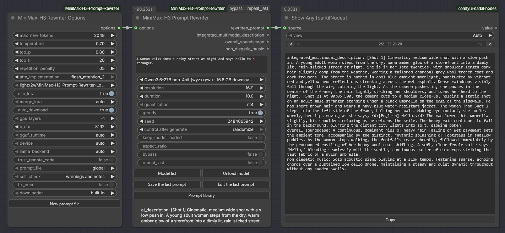
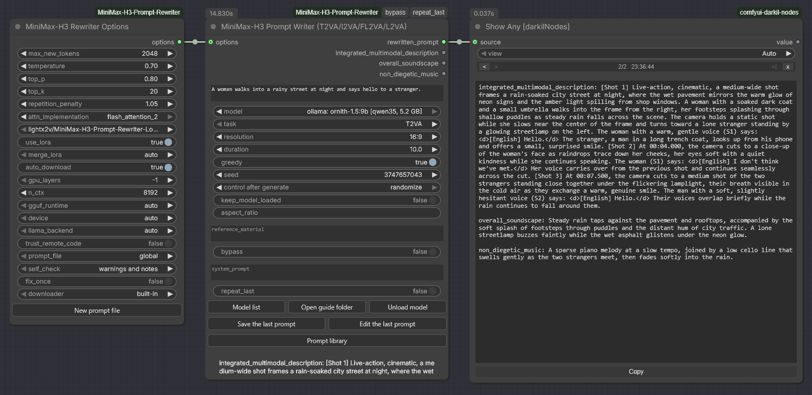

# MiniMax-H3 Prompt Rewriter для ComfyUI

Ноды ComfyUI для [LightX2V MiniMax-H3 T2VA Prompt Rewriter LoRA](https://huggingface.co/lightx2v/MiniMax-H3-Prompt-Rewriter-LoRA).
На входе короткий промпт — на выходе структурированное описание аудио-видео сцены
для [MiniMax-H3](https://huggingface.co/MiniMaxAI/MiniMax-H3). Полностью локально.

[English version](README.md) · [История изменений](CHANGELOG_RU.md)



Промпт можно писать на любом языке, который понимает базовая модель, — результат
всё равно придёт на английском, как того и ждёт MiniMax-H3.

```text
«Рыжая лиса идёт по заснеженному лесу на рассвете.»  +  16:9  +  15 с
                              │
                              ▼
              Qwen3.6-27B + Prompt Rewriter LoRA
                              │
                              ▼
   integrated_multimodal_description: [Shot 1] ... [Shot 2] 0:06 ...
   overall_soundscape: ...
   non_diegetic_music: ...
                              │
                              ▼
              MiniMax-H3: видео + синхронный звук
```

Получить такой результат можно двумя способами, и в паке есть оба:

| | Нода ререйтера | Ноды писателя |
|---|---|---|
| Откуда берётся формат | из LoRA — 27B обучали, пока формат H3 не начал выходить сам | из собственного руководства MiniMax, в системном промте |
| Модель | только Qwen3.6-27B | любая GGUF, умеющая следовать инструкциям |
| Минимальная рабочая конфигурация | ~10 ГБ загрузки, ~13 ГБ VRAM | **2.6 ГБ загрузки, ~5 ГБ VRAM** |
| Задачи | T2VA | T2VA, I2VA, FL2VA, L2VA, Ref2VA |
| Качество | эталон | близко — и работает там, где LoRA не запустится вовсе |

Обе читают текст. Третья нода — [Reference Caption](#minimax-h3-reference-caption) —
превращает картинку, звук или видео в тот текст, который им нужен: 3–5 секунд на
ассет на модели в 3.4 ГБ. А когда референсов на целый кадр, их описывает разом
[Multi Reference Caption](#minimax-h3-multi-reference-caption), а
[Reference Writer (Ref2VA)](#minimax-h3-reference-writer-ref2va) делает это и
сразу переписывает, в одной ноде.

Если у вас 8 ГБ видеопамяти, переходите сразу к [нодам писателя](#minimax-h3-prompt-writer-t2vai2vafl2val2va).

## Что потребуется до установки

Путь через LoRA — это языковая модель на 27 миллиардов параметров, а не лёгкий
помощник. Обойти приведённые ниже требования нельзя: адаптер привязан к одной
конкретной базовой модели. **К нодам писателя ничего из этого не относится** —
их требования в таблице ниже.

| Ресурс | Требование |
|---|---|
| Диск | **~52 ГБ** под `Qwen/Qwen3.6-27B` + **~3.5 ГБ** под адаптер — либо **~10–16 ГБ** всего на пути GGUF |
| VRAM (`nf4`, по умолчанию) | **~16 ГБ** |
| VRAM (`int8`) | ~28 ГБ |
| VRAM (`bfloat16`) | ~54 ГБ, излишек accelerate вытеснит в оперативную память |
| VRAM (GGUF) | ~13–19 ГБ в зависимости от кванта, меньше — если выгрузить на GPU не все слои |
| Пакеты | `transformers`, `peft`, `accelerate`, для `nf4`/`int8` — `bitsandbytes`; для GGUF — `llama-cpp-python` |

> **Текстовый энкодер MiniMax-H3 для этого переиспользовать нельзя.** Это другая
> модель: Qwen3-VL-32B со словарём 151936 против базы адаптера Qwen3.6-27B со
> словарём 248320. В нём нет ни одного модуля linear-attention `in_proj_*`, на
> которые вешается адаптер; он обрезан до первых 50 слоёв из 64; и в нём нет ни
> `lm_head`, ни финальной нормализации, то есть генерировать текст он физически
> не может. Он отдаёт только скрытые состояния для DiT.

## Установка

Склонировать в `ComfyUI/custom_nodes/` и поставить зависимости в то же
Python-окружение, в котором работает ComfyUI:

```bash
cd ComfyUI/custom_nodes
git clone https://github.com/pytraveler/MiniMax-H3-Prompt-Rewriter-ComfyUI
```

Для portable-сборки ComfyUI под Windows:

```bat
python_embeded\python.exe -m pip install -r ComfyUI\custom_nodes\MiniMax-H3-Prompt-Rewriter-ComfyUI\requirements.txt
```

Либо установить из реестра Comfy через ComfyUI-Manager.

## Ноды

### MiniMax-H3 Prompt Rewriter

Основная нода. Сама докачивает недостающее, загружает модель, генерирует и
освобождает VRAM обратно.

**Выходы**

| Имя | Содержимое |
|---|---|
| `rewritten_prompt` | Полный переписанный промпт — готов к подаче в MiniMax-H3 |
| `integrated_multimodal_description` | Только визуальная часть, разбитая по шотам |
| `overall_soundscape` | Только диегетический звук |
| `non_diegetic_music` | Только закадровая музыка |

**Входы**

- `prompt` — короткий промпт, который надо развернуть.
- `model` — базовая модель. В списке все записи из вашего файла моделей плюс все
  Qwen3.6-27B, уже лежащие на диске (с префиксом `on disk:`). Чего нет — скачается
  при первом запуске, прерванная загрузка продолжится. Кнопка **Open model list**
  открывает файл со списком — см. ниже.
- `resolution` / `duration` — условия, под которые составляется описание. Держите
  их равными тем, что подаёте в MiniMax-H3, иначе ритм шотов не совпадёт.
- `quantization` — как грузить *неквантованный* чекпоинт: `nf4` (по умолчанию,
  ~16 ГБ VRAM), `int8` (~28 ГБ), `bfloat16` / `float16` (~54 ГБ). Игнорируется,
  если у чекпоинта своя квантизация.
- `greedy` — включён по умолчанию, результат детерминированный.
- `seed`
- `keep_model_loaded` — **по умолчанию выключен.** Модель на 27B выгружается сразу
  после генерации, чтобы на той же видеокарте следом отработала генерация видео
  H3. Включайте только когда подряд перебираете варианты промпта.
- `options` — опционально; подключите ноду **MiniMax-H3 Rewriter Options**.

### MiniMax-H3 Rewriter Options

Всё, что трогают редко, убрано с основной ноды. Если её не подключать, ререйтер
работает с теми параметрами декодирования, с которыми адаптер был опубликован.


| Вход | По умолчанию | Назначение |
|---|---|---|
| `max_new_tokens` | 2048 | Предел генерации |
| `temperature` / `top_p` / `top_k` | 0.7 / 0.8 / 20 | Сэмплирование, работает только при выключенном `greedy` |
| `repetition_penalty` | 1.05 | |
| `attn_implementation` | `sdpa` | `eager` или `flash_attention_2`, если установлен |
| `adapter` | репозиторий LightX2V | Идентификатор репозитория или локальная папка LoRA — см. ниже |
| `use_lora` | вкл | Выключите, чтобы сравнить с чистой Qwen3.6-27B |
| `auto_download` | вкл | Выключите, чтобы нода падала с ошибкой вместо скачивания 52 ГБ |
| `device` | `auto` | На какой карте считать языковую модель — см. ниже |
| `trust_remote_code` | **выкл** | Разрешить чекпоинту исполнить питон, который лежит внутри него — см. ниже |

Эта же нода настроек подходит нодам писателя и капшенеру; `adapter` и `use_lora`
там просто не применяются.

#### `adapter` — единственное поле, которое ещё может выбрать воркфлоу

Все модели на этих нодах выбираются из выпадающего списка, поэтому сохранённый
воркфлоу несёт *название* записи и никогда — путь: пути лежат в вашем
`models.json`, который остаётся на вашей машине. `adapter` — исключение: это
текстовое поле, потому что указать в нём `.gguf`-LoRA, которую вы сконвертировали
сами, людям действительно нужно. А значит, скачанный воркфлоу может его
заполнить.

Отсюда два следствия — оба закрыты, и ни одно из них вас не ограничивает:

- **Сетевой путь отклоняется.** `\\хост\шара\...` и `//хост/шара/...` отбиваются
  до того, как их кто-либо прочитает: одно только обращение к такому пути — это
  попытка аутентификации на указанном хосте. Своя шара доступна по букве диска
  или точке монтирования, как и раньше, а путь в `models.json` не ограничен
  ничем — этот файл ваш и никуда не уезжает.
- **Применённый адаптер пишется в лог** на каждом запуске. Если запрошен не тот
  адаптер, что настроен, консоль скажет об этом на уровне warning. Подменённая
  LoRA иначе невидима: нода так же отрабатывает и так же заполняет все поля,
  просто пишет другое.

#### `trust_remote_code` — выключен, и почему

Чекпоинт для Transformers может нести собственный код модели: он объявлен через
`auto_map` в `config.json`, и при загрузке такой модели этот питон импортируется
и выполняется с правами вашего пользователя. В поставляемом списке таких моделей
нет: все записи формата `transformers` — это варианты Qwen3.6-27B, архитектуры,
поддержанной в Transformers нативно, а записи GGUF до Transformers вообще не
доходят. Поэтому переключатель выключен, и для моделей из списка ноды он ничего
не меняет.

Он нужен для случая, когда это важно, — для модели, которую вы сами добавили в
`models.json`, с архитектурой, неизвестной Transformers. Тогда нода остановится
и скажет об этом, а не выполнит код; включённый переключатель — это ваши слова о
том, какой модели вы доверяете. Решение принимает человек, а не `config.json` из
чужой папки, и ровно поэтому это виджет.

#### `device` — и почему он меняет смысл `keep_model_loaded`

У каждой ноды здесь было одно и то же предупреждение: выключите
`keep_model_loaded`, потому что карта понадобится под генерацию видео сразу после
ререйта. Это предупреждение существует только потому, что обеим моделям нужна
одна и та же карта. **Когда карт две — не нужна.**

Значения: `auto`, `cpu` и по одному `cuda:N` на каждое устройство, которое видит
ComfyUI. Одно написание, три бэкенда:

| | `auto` | `cuda:1` | `cpu` |
|---|---|---|---|
| бинарники llama.cpp | как было | `--device CUDA1` | `--device none`, 0 слоёв |
| llama-cpp-python | как было | `main_gpu=1`, split mode `NONE` | `n_gpu_layers=0` |
| Transformers | `device_map="auto"` | `device_map={"": "cuda:1"}` | `{"": "cpu"}` |

Главное здесь не размещение. **На другой карте модели самого ComfyUI больше не
выгружаются перед запуском.** Сейчас это делает безусловно каждый бэкенд — что
правильно, когда обеим нужна одна VRAM, и чистая потеря, когда нет: это полная
перезагрузка диффузионной модели после каждого ререйта. Выберите вторую карту — и
ререйтер грузится рядом, `keep_model_loaded` становится осмысленным, и ничему не
приходится двигаться.

Две детали. Устройство, которого на машине нет, **отклоняется, а не подменяется
молча** — воркфлоу, принесённый с двухкарточной машины, честно об этом скажет,
вместо того чтобы уехать на чужую карту и выселить батч на середине. И нумерация
здесь — та же, что у ComfyUI: запущенный с `--cuda-device 1` ComfyUI видит ровно
одно устройство, и это `cuda:0`, в том числе для подпроцессов.

Значения намеренно простые, а не `cuda:1 · RTX 4090`: подпись с названием карты
читается приятнее и ломает все сохранённые воркфлоу в день замены карты. Что
именно стоит в каждом слоте — написано в подсказке.

### MiniMax-H3 Prompt Writer (T2VA/I2VA/FL2VA/L2VA)

Те же три поля на выходе — без LoRA и без 27B. В системный промт кладётся
[руководство MiniMax по написанию промтов](https://huggingface.co/MiniMaxAI/MiniMax-H3/blob/main/docs/VIDEO_PROMPT_WRITING_GUIDE_base_en.md),
и по нему пишет любая GGUF-модель, умеющая следовать инструкциям. Qwen3.5-9B на
5.2 ГБ заполняет все три поля — с правильным словарём движений камеры,
идентификаторами говорящих и репликами `<d>[English] …</d>` — примерно за 20 секунд.



*T2VA, 10 секунд в 16:9, на локальном Qwen3.6-27B — 11.2 с. Промт был написан
по-русски, описание вернулось в английском формате H3 — со склейкой на
00:03.000, которую промт и просил, и с `non_diegetic_music: N/A`, потому что
музыки просили не давать.*

Компромисс стоит назвать прямо. LoRA **и есть** формат: 27B обучали до того, что
вывод H3 получается из семи строк системного промта. Здесь формат несут ~4000
токенов инструкций, которым модель должна следовать, — так что проза LoRA будет
плотнее, а форматирование надёжнее. Зато это работает на железе, к которому LoRA
не подступится.

Выходы полностью совпадают с нодой ререйтера — те же имена, тот же порядок, — так
что в сохранённом воркфлоу их можно менять местами.

Сверх входов ререйтера:

- `task` — **T2VA**, **I2VA**, **FL2VA** или **L2VA**. Всё, кроме T2VA, ещё и
  выдаёт строку выравнивания, которую H3 требует самой первой строкой, с уже
  подставленной длительностью до двух знаков; модели остаётся только номер
  финального кадра.
- `reference_material` — **эта нода читает текст, а не пиксели.** Для I2VA, FL2VA
  и L2VA опишите, что на референсных кадрах — руками или нодой
  [Reference Caption](#minimax-h3-reference-caption) выше по графу. Без этого
  модель придумает первый кадр, не имеющий отношения к вашей картинке.

В `model` попадают раздел `writers` из списка моделей и все GGUF, уже лежащие в
модельных папках ComfyUI, любой архитектуры. Ничему здесь не нужно быть
Qwen3.6-27B, и ставить тоже ничего не нужно: без `llama-cpp-python` нода запускает
официальные бинарники llama.cpp — так же, как на пути GGUF ниже.

| Модель-писатель | Загрузка | VRAM с руководством в контексте |
|---|---|---|
| Qwen3.5-4B `Q4_K_M` | 2.6 ГБ | ~5 ГБ — начните с неё на 8 ГБ |
| Qwen3.5-9B `Q4_K_M` | 5.3 ГБ | ~8 ГБ — лучший текст на гигабайт |
| Qwen3.5-9B Uncensored (HauhauCS) `Q4_K_M` | 5.2 ГБ | ~8 ГБ — не отказывается от сцен, которые отклоняет сток |
| Gemma 3 12B Instruct `Q4_K_M` | 6.8 ГБ | ~10 ГБ — альтернатива не от Qwen |
| Mistral Small 3.2 24B Instruct `Q4_K_M` | 13.4 ГБ | ~17 ГБ — для карт от 16 ГБ |

`n_ctx` поднимается автоматически: базовому руководству нужно около 9200 токенов
контекста, полнореференсному — около 12300, против значения по умолчанию 8192,
которое подходит короткому системному промту LoRA. Если позволить llama.cpp
обрезать, отрезано будет *начало* промта — руководство и контракт вывода, — и
ответ вернётся в каком-то другом формате без единого слова о причине.

Если поля не хватает, нода всё равно вернёт всё, что получила, и напишет на самой
ноде, каких полей нет. Снизьте температуру или возьмите модель на размер больше.

### MiniMax-H3 Prompt Writer (Ref2VA)

Полнореференсный режим по
[руководству MiniMax для full-reference](https://huggingface.co/MiniMaxAI/MiniMax-H3/blob/main/docs/VIDEO_PROMPT_WRITING_GUIDE_ref_en.md).
Шесть разделов вместо трёх, каждый — отдельный выход:

| Выход | Содержимое |
|---|---|
| `subject_definitions` | что обозначает каждая метка `<Subject N>` / `<Picture N>` / `<Video N>` / `<Audio N>` |
| `summary` | префикс `[тип задачи]` и референсные связи одним абзацем |
| `retention_analysis` | по метке: `fully_preserved`, `partially_preserved`, `attribute_transfer`, `weak_reference`, `fully_copy`, … |
| `detailed_description` | тело, кадр за кадром, со ссылками на метки там, где их роль действует |
| `overall_soundscape` | атмосфера и звуки действий |
| `non_diegetic_music` | музыка, слышная только зрителю |


*Тот же клип, что и выше, плюс одна строка `Picture 1:` в `reference_assets` —
17.4 с. Модель сама выбрала тип задачи, привязала `<Subject 1>` к коту, а
`<Picture 1>` — к стилю рисунка, и сама написала анализ удержания.*

`reference_assets` — **обязательное** поле, пустым не принимается:
полнореференсный режим описывает, как целевое видео переиспользует ассеты, а без
ассетов это просто T2VA под другим названием. По одному в строке —

```text
Picture 1: young woman, long dark hair, blue cardigan, thin silver necklace
Picture 2: corner cafe interior, brick wall, brass lamps, rain on the window
Audio 1: voice-timbre reference for the woman — low, unhurried, slight rasp
```

— а модель по ним расставит метки, выберет тип задачи и напишет retention-анализ.
Либо пусть эти строки напишет за вас
[MiniMax-H3 Reference Caption](#minimax-h3-reference-caption) — прямо из самих
ассетов.

### MiniMax-H3 Reference Caption

Ноды-писатели читают текст, а не пиксели. Вот откуда берётся этот текст:
подключаете картинку, аудиоклип или видео — и маленькая мультимодальная модель
описывает их одной размеченной строкой `reference_assets`.

Замерено на Qwen2.5-Omni-3B в 3.4 ГБ: **3 с на кадр, 2 с на аудиоклип, 5 с на
видео.** Работает через те же бинарники llama.cpp, что и всё остальное:
`llama-mtmd-cli` лежит в том же архиве, который ререйтер уже скачивает, — так что
машина, где хоть раз выполнялся ререйт, не качает никакого рантайма.

**Соединяются в цепочку** проводом из `reference_assets` во вход `previous`
следующей ноды. Каждая метка нумеруется **внутри своей категории** — это
собственное правило руководства («`<Video N>` and `<Audio N>` are numbered
independently»), поэтому четыре ассета выйдут как `Picture 1`, `Picture 2`,
`Video 1`, `Audio 1`, а не как 1–4.


*Картинка и аудиоклип через Qwen2.5-Omni-7B — 4.4 с и 3.7 с. Вторая нода
получила блок первой на `previous` и дописала в него свою строку, а роль `Audio`
описала голос, а не расшифровала его: «a male speaker with a calm and measured
delivery, speaking in Russian».*

`role` выбирает и метку, и вопрос к модели, и вопросы различаются намеренно:

| `role` | О чём спрашиваем модель |
|---|---|
| `Subject` | признаки, которые должны сохраняться между кадрами — телосложение, волосы, одежда и её цвета, предметы в руках |
| `Picture` | кадр как кадр — стиль, крупность, ракурс, положение в кадре, окружение, свет |
| `Video` | субъекты, действия по порядку, движение камеры, склейки и их ритм |
| `Audio` | **звук, а не слова** — тембр голоса, возраст и пол на слух, подача и темп, инструментал, темп, эмбиенс |

Последняя строка — самая важная. `<Audio N>` в руководстве чаще всего именно
*тембровый* референс, а транскрипт выбрасывает ровно ту часть, которая нужна, —
поэтому в инструкции прямо написано «do not transcribe». Если дословные слова
всё же нужны для блока `<d>`, это работа для ASR: прогоните Whisper отдельно и
вставьте строку руками.

Остальные входы:

- `description` — впишите описание сами, и **никакая модель не запустится вовсе**.
  Самый быстрый способ добавить ассет, который описывается шестью словами.
- `instruction` — полностью заменить вопрос роли.
- `max_frames` — сколько кадров взять из батча IMAGE **или из VIDEO**, равномерно.
  Все сразу переполнили бы и контекст, и терпение: две секунды при 25 fps — это
  56 картинок через визуальную башню, а тридцать секунд — 750. Именно это и
  делает стоимость описания клипа не зависящей от его длины.
- `context_size` — `0` означает «контекст самой модели», под который её проектор
  и рассчитан: один кадр 1024×1024 — это уже больше двадцати медиа-чанков.
  Уменьшайте только чтобы срезать KV-кэш, и учтите, что слишком малое значение
  роняет запуск, а не обрезает его.

> **Не всякий мультимодальный GGUF здесь работает**, и те, что не работают,
> падают громко. `mtmd` в llama.cpp должен понимать формат проектора: у Gemma 4
> он валит процесс целиком на `b10310` — и с файлом самой Google, и с файлом
> unsloth, и на CUDA-сборке, и на CPU, — тогда как `llama-completion` гоняет ту
> же модель как текстовую без единой жалобы. Поэтому в списке `captioners` лежат
> только пары, которые действительно запускались:
>
> | Капшенер | Загрузка | Модальности |
> |---|---|---|
> | Qwen2.5-Omni-3B `Q4_K_M` + mmproj | 3.4 ГБ | картинка, звук, видео |
> | Qwen2.5-Omni-7B `Q4_K_M` + mmproj | 5.8 ГБ | картинка, звук, видео |
>
> Модель и её `mmproj`, лежащие вместе в одной папке внутри `models/LLM`,
> предлагаются автоматически — так что попробовать другую можно ничего не правя.

**Рассуждающая модель обрабатывается, а не отвергается.** Qwen3-VL и Gemma-4 E4B
пишут блок `<think>` что бы ни говорила инструкция — на GGUF-маршруте попросить
их не делать этого нечем: `llama-mtmd-cli` применяет шаблон чата сам и
переключателя `enable_thinking` не имеет. Всё до закрывающего тега вырезается, так
что в `reference_assets` попадает только ответ. Счётчик символов на ноде остаётся
исходным — по нему и видно модель, потратившую бюджет на размышления вместо
описания; а если она потратила там *весь* бюджет и описания так и не написала,
нода об этом скажет, а не выдаст пустую метку.

### MiniMax-H3 Multi Reference Caption

Та же работа сразу на весь кадр, в одной ноде. Цепочка точна, но она разрастается:
пять референсов — это пять нод, пять проводов и пять шансов оставить где-нибудь не
ту роль. Эта нода сворачивает цепочку в одну коробку и вовсе забирает выбор роли:
**метка задаётся тем, в какую группу воткнут ассет.**

Это словарь руководства, ставший структурой. Ref2VA определяет ровно четыре
референсные метки и запрещает выдумывать новые — значит четыре группы входов
покрывают формат полностью, и описать картинку как звук становится *невозможно*,
а не просто нежелательно.

| Группа | Метка | Что сюда идёт |
|---|---|---|
| `subjects` | `<Subject N>` | переиспользуемое видимое содержимое — человек, животное, место, костюм, стиль |
| `pictures` | `<Picture N>` | картинка как настоящий кадр: первый, последний, ключевой, композиционный якорь, раскадровка |
| `videos` | `<Video N>` | отношения на уровне целого видео — исходник монтажа, точка продолжения, работа камеры и ритм |
| `audios` | `<Audio N>` | тембр голоса, музыка, эмбиенс, эффект |

Слоты растут по мере заполнения, один свободный всегда наготове, — нода ровно
такой высоты, какой требует кадр, и ни строкой больше.


*Два ассета через Qwen2.5-Omni-3B — 6.0 с. Видео подключено и выключено, поэтому
блок вышел как `Subject 1` и `Audio 1`, без строки `Video` вовсе: референс
остаётся в графе, просто на этом прогоне он ничего не стоит.*

**Чекбокс на строке самого слота выключает его**, ничего не отсоединяя. Капшен
стоит загрузки модели и от секунд до минут, поэтому «всё, кроме вот этого» —
самое обычное желание, а выдёргивать ради него провод значит терять ровно ту
разводку, которую вы и хотели сохранить. Состояние сохраняется с воркфлоу и
уходит через API, как любое другое значение.

**Слот `videos` принимает и `VIDEO`, и батч `IMAGE`** — смотря что отдаёт ваш
загрузчик; `Load Video (Upload)` из VideoHelperSuite подключается напрямую. Кадры
в обоих случаях сэмплируются равномерно до `max_frames`, так что стоимость клипа
по-прежнему не зависит от его длины.

**Блок пишется в порядке руководства** — субъекты, картинки, видео, аудио, — а не
в порядке проводов, и каждая метка нумеруется внутри своей категории, продолжая
то, что пришло на `previous`. Так что нода спокойно стоит в цепочке с одиночными
нодами по обе стороны.

`model`, `length`, `seed`, `max_frames`, `context_size` и `bypass` общие для всех
ассетов ноды. `role`, `description` и `instruction` убраны намеренно: роль — это
группа, а текст, написанный руками, относится к одному ассету за раз. Для ассета,
который хочется описать самому или спросить о нём иначе, остаётся
[Reference Caption](#minimax-h3-reference-caption).

> **Этой ноде нужен свежий ComfyUI.** Её растущие входы — это `io.Autogrow` из
> v3-API нод. На старой сборке пропадёт только она одна — остальной пак
> зарегистрируется ровно как прежде.

### MiniMax-H3 Reference Writer (Ref2VA)

Чтение и написание в одной коробке.
[Multi Reference Caption](#minimax-h3-multi-reference-caption) превращает пиксели
в текст, [Prompt Writer (Ref2VA)](#minimax-h3-prompt-writer-ref2va) — этот текст
в шесть разделов, а между ними идёт один провод `reference_assets`. Как только
одной модели хватает на обе половины — мультимодальный GGUF, который к тому же
следует руководству по написанию, — этот провод остаётся единственным, что
разделяет две ноды, всегда работающие вместе, у каждой из которых свой блок
опций, свой seed и свой язык вывода, которые надо держать в согласии. Эта нода —
те две с вынутым проводом.


*Три картинки, описаны и переписаны за один запуск — 242.8 с вхолодную на 3090,
~157 с с закэшированными весами. Оба меню моделей указывают на один и тот же
файл: одна запись несёт `mmproj` и читает картинки, другая нет и пишет промпт.*


**Экономится проводка, а не время.** Меню моделей два, а не одно: `captioner`
перечисляет мультимодальные пары, `writer` — все текстовые GGUF. Укажите обоим
один и тот же файл — это всё равно две загрузки: captioner идёт через
`llama-mtmd-cli`, а writer через `llama-completion`, и объединение в одну коробку
второй бинарник не убирает.

Замерено здесь на RTX 3090, Qwen3.8-27B-abliterated `Q4_K_M` в обоих меню и
три картинки-референса: **242.8 с** на первом запуске и **~157 с** на
следующем, пока веса ещё в кэше, — ровно столько же тот же граф стоил двумя
отдельными нодами (101 с описание + 56 с написание). Экономится провод, как и
было сказано.

Четыре группы входов, метки, которые они дают, и переключатель на строке каждого
слота — это [Multi Reference Caption](#minimax-h3-multi-reference-caption), так
что всё, что сказано о них в том разделе, верно и здесь. `clip` работает так же.

| Выход | Что несёт |
|---|---|
| `rewritten_prompt` | весь ответ целиком |
| шесть выходов-разделов | `subject_definitions` … `non_diegetic_music`, разобранные |
| `reference_assets` | блок, который нода собрала и отдала писателю |
| `captions` | только описания, по одному на строку |

`reference_assets` вынесен наружу намеренно: когда переписанный промпт выходит не
таким, первый вопрос — что писателю вообще дали.

**Один seed управляет обеими половинами** — описаниями и переписыванием. В этом и
смысл объединения, и это же единственное, что граф, перенесённый с версии из двух
нод, воспроизвести не сможет: там seed был у каждой свой.

**Нет референсов — нет переписывания.** Если ни один ассет не вернул описания,
writer не запускается вовсе: иначе Ref2VA-промпт, вся посылка которого — его
референсы, был бы составлен без единого, после минуты генерации, о которой никто
не просил. Отдельный сбойный ассет просто пропускается, вместе с меткой, и сводка
ноды его считает.

> **Этой ноде нужен свежий ComfyUI** — по той же причине с `io.Autogrow`. Она и
> `Multi Reference Caption` регистрируются независимо, так что версия,
> отвергающая одну, всё же получит другую.

### Описание моделью, которая у ComfyUI уже загружена

У обеих caption-нод и у `Reference Writer (Ref2VA)` есть вход `clip`. Подключите к нему мультимодальный текстовый
энкодер из `CLIPLoader` — и каждый ассет будет описан *этой* моделью, а не GGUF
из `model`; модель при этом остаётся ровно там, куда её положил аллокатор
ComfyUI.

В этом и весь смысл. Маршрут через GGUF поднимает `llama-mtmd-cli` по процессу на
ассет, поэтому кадр с пятью референсами читает веса с диска пять раз. Загруженный
энкодер читается **один раз**, а перезапуски при подборе формулировок не стоят
вообще ничего. Замерено здесь: три ассета — картинка, клип и его звуковая
дорожка — через Gemma-4 12B за **24 с**, и в логе на всех них один-единственный
`Requested to load`.

Только не читайте это как «быстрее». Те же три ассета через Qwen2.5-Omni-3B в
3.4 ГБ по маршруту GGUF заняли **16 с** вместе со всеми загрузками: маленькая
модель грузится достаточно быстро, чтобы три её перезагрузки обошлись дешевле
одного прохода 12B. Этот маршрут даёт не скорость, а *большую* модель без платы
за перезагрузку и перезапуски, которые загрузку пропускают вовсе, — и разрыв
растёт с каждым ассетом и каждым перезапуском.

Какие энкодеры подходят и что каждый принимает:

| Энкодер | Видит | Слышит |
|---|---|---|
| Qwen3-VL 4B / 8B | да — батч кадров читается покадрово | нет |
| Gemma-4 12B | да | **да** — сборка «unified», аудио проецируется напрямую |
| Gemma-4 E2B / E4B | да | детали на месте, но см. ниже |
| Gemma-4 31B | да | нет |

Gemma-4 опознаётся по самому чекпоинту, поэтому виджет `type` у `CLIPLoader` для
неё роли не играет. Подключите энкодер без слуха вместе со звуком — нода
откажется до запуска, ровно как отказывается на проекторе без аудиобашни.

> **Две вещи про Gemma-4 E2B/E4B.** Обе наблюдались на ComfyUI 0.30 с fp8-сборкой
> E4B и обе воспроизводятся штатной нодой ComfyUI `Generate Text` на том же
> файле — то есть ни одна из них не чинится силами этого пака:
>
> - **Аудио не доходит.** Капшен возвращается словами о том, что клип не был
>   предоставлен. Нода не отказывает, а пишет предупреждение в лог, когда видит
>   энкодер такой формы: на другом чекпоинте это может и работать. Gemma-4 12B
>   принимает звук правильно.
> - **Она размышляет вслух.** Промпт примирует пустой канал мыслей, а эта сборка
>   всё равно его заполняет. Caption-ноды срезают всё до закрывающего тега,
>   поэтому в `reference_assets` попадает только ответ, — но если вы собираете
>   `Generate Text` руками, срезать придётся вам.

Два виджета на этом маршруте мертвы, и в подсказках об этом сказано: `model`,
который вообще не читается, и `context_size` — это ручка KV-кэша llama.cpp.
`max_frames` работает по-прежнему: кадры прореживаются здесь, до того как их
увидит энкодер, а не отдаются на откуп его собственному сэмплированию до 1 fps.

Маршрут через GGUF никуда не девается: он достаёт модели, для которых у ComfyUI
энкодера нет, и ему ничего не нужно загружать заранее. Оставьте `clip`
неподключённым — и в обеих нодах не изменится ничего.

### MiniMax-H3 Guide Prompt (any LLM)

Собирает `system_prompt` и `user_prompt` по руководству и отдаёт их строками,
ничего не запуская. Не стоит ни видеопамяти, ни времени. Подключите их к той
LLM-ноде, которой вы уже пользуетесь — локальной, API, удалённой, — если модель
удобнее гонять не здесь. Поддерживает все пять задач, включая Ref2VA.

Третий выход, `prompt`, — это оба промпта одной строкой, потому что почти все
LLM-ноды принимают ровно один. **В том числе штатная `Generate Text`**, которая
с версии 0.30 гоняет языковую модель прямо в процессе ComfyUI, взяв её из
`CLIPLoader`. Это самый короткий путь к формату этого пака вообще без загрузки
GGUF — если текстовый энкодер Qwen3-VL или Gemma-4 у вас и так лежит ради
картиночной модели:


*Ref2VA через Qwen3.5 в 4B — 37.7 с, и все шесть секций вернулись. Самое полезное
число — на статусной строке самой ноды: системный промпт в 25 042 знака это
**около 10 240 токенов контекста** до того, как модель напишет первое слово, и
именно это решает, потянет ли конкретный энкодер такую задачу вообще.*

Три настройки на `Generate Text` решают, заработает это или нет:

- **`max_length`** — её значение по умолчанию, 512, это бюджет *вывода*, и шесть
  секций Ref2VA в него не помещаются. Нужно порядка **2048** — столько же
  используют собственные писатели этого пака (`max_new_tokens` в ноде опций).
  Замерено на Qwen3-VL в 4B: переписывание Ref2VA вернулось целиком за **53 с
  вместе с загрузкой модели**, остановившись само примерно на 580 токенах — то
  есть внутри 2048 с запасом и настолько дальше 512, что значение по умолчанию
  оборвало бы ответ на середине секции.
- **`thinking`** — выключить. Руководство просит поля и ничего кроме, а
  размышления тратят тот самый бюджет на текст, который потом придётся срезать.
- **`use_default_template`** — оставить включённым, а `format` — на `plain`.

`format` — единственная ручка, о которой стоит знать. На `plain` два промпта
склеиваются пустой строкой, а LLM-нода заворачивает результат в собственный
шаблон модели, из-за чего всё руководство оказывается внутри *пользовательского*
хода. На `chatml` ходы расписываются здесь: токенизатор Qwen пропускает свой
шаблон, как только текст начинается с `<|im_start|>`, и руководство приходит
настоящим системным сообщением. В этой же ветке пропускается и подавление
размышлений у Qwen, поэтому пустой блок `<think>` дописывается за вас. По
устройству это заточено под Qwen — на Gemma и всём остальном оставайтесь на
`plain`.

### Руководства скачиваются, а не поставляются в паке

Двух руководств внутри пака нет. Это Documentation компании MiniMax, а MiniMax H3
Community License разрешает распространять Materials только внутри своей
«Applicable Territory» — весь мир *за исключением* Европейского союза,
Великобритании, Республики Корея и США — и только вместе с копией соглашения и
файлом NOTICE. Пак нод в реестре не может соблюдать территориальную границу,
поэтому каждая установка при первом обращении скачивает свою копию напрямую у
MiniMax: 16 КБ и 24 КБ, один раз, под тем же переключателем `auto_download`.

Ложатся они в

```text
ComfyUI/user/minimax_h3_rewriter/guides/
```

и эту папку открывает кнопка **Open guide folder**. Правка копии меняет системный
промт, а скачивание никогда не перезаписывает уже лежащий файл — обрезать
руководство проще всего, когда контекста маленькой модели не хватает.

### Список моделей

Кнопка **Open model list** на ноде ререйтера открывает

```text
ComfyUI/user/minimax_h3_rewriter/models.json
```

в системном редакторе JSON — **на той машине, где работает ComfyUI**, а не обязательно
на той, где открыт браузер. Файл засевается из поставки при первом обращении, поэтому
обновление пака не затирает ваши правки.

В файле три списка с одинаковыми полями. **`models`** питает ноду ререйтера, и там
обязательно должна быть Qwen3.6-27B:

```json
{
  "name": "Qwen3.6-27B FP8",
  "repo": "Qwen/Qwen3.6-27B-FP8",
  "download_gb": 28.8,
  "vram": "~29 GB, no extra package needed"
}
```

**`writers`** питает ноды писателя, и там может быть что угодно — лишь бы это была
GGUF-модель языка с чат-шаблоном:

```json
{
  "name": "Qwen3.5-4B",
  "repo": "unsloth/Qwen3.5-4B-GGUF",
  "file": "Qwen3.5-4B-Q4_K_M.gguf",
  "format": "gguf",
  "download_gb": 2.6,
  "vram": "~5 GB with the guide in context"
}
```

**`captioners`** питает ноду Reference Caption, и там нужно одно дополнительное
поле — `mmproj`: мультимодальная модель это два файла, и оба должны быть из одной
конвертации:

```json
{
  "name": "Qwen2.5-Omni-3B",
  "repo": "ggml-org/Qwen2.5-Omni-3B-GGUF",
  "file": "Qwen2.5-Omni-3B-Q4_K_M.gguf",
  "mmproj": "mmproj-Qwen2.5-Omni-3B-Q8_0.gguf",
  "format": "gguf",
  "download_gb": 3.4
}
```

#### Как указать файл, который уже лежит на диске

`repo` не обязан быть идентификатором с Hugging Face. Укажите там **папку на этой
машине** — и файл будет прочитан прямо из неё, без скачивания и без копирования:

```json
{
  "name": "Gemma 4 26B",
  "repo": "X:/models/gemma-4-26B-A4B-it-UD-Q8_K_XL",
  "file": "gemma-4-26B.gguf",
  "format": "gguf"
}
```

Либо положите весь путь в `file`, а `repo` не указывайте вовсе — работают обе
формы и во всех трёх секциях, потому что обе люди и пишут. Два подводных камня:

- **Обратные слэши в JSON нужно удваивать** — или писать прямые. `"X:\Programs\..."`
  вообще не валидный JSON: `\P` не является escape-последовательностью, и один
  такой символ делает нечитаемым **весь файл**, а не одну запись. Windows
  прекрасно понимает `X:/Programs/...`, так что это привычка попроще.
- Несуществующий путь **называется вслух, а не обходится скачиванием**. Нода
  скажет, какой файл не нашла, и остановится.

Если у вас целая папка с GGUF где-то в стороне, заводить запись на каждый файл —
долгий путь: пропишите её в `extra_model_paths.yaml` под ключом `LLM`, и все
файлы оттуда появятся в списке сами, с префиксом `on disk:`.

Добавили запись, **обновили вкладку браузера** — перезапускать ComfyUI не нужно —
и она в списке. `name` лучше не менять: сохранённые воркфлоу помнят именно
подпись, и нода с пропавшим выбором честно скажет об этом по имени, а не
подставит молча что-то другое.

#### Когда сломан сам список

Синтаксическая ошибка в `models.json` была самым тихим отказом во всём паке:
разбор падал, вместо вашего списка подставлялся упакованный по умолчанию, и
выпадашка выглядела совершенно обычно. Правка, которая не применилась, была
неотличима от правки, которая ничего не изменила.

Теперь об этом говорит первая же строка в каждом списке моделей — с номером
строки и позиции:

```text
!! models.json is not valid JSON — Invalid \escape: line 3 column 30 (char 46) — showing the packaged list instead
```

Остальной список при этом на месте и ComfyUI работает; если выбрать эту строку и
нажать Run, сообщение повторится и назовёт файл, который надо починить. Почините,
обновите вкладку — и оно исчезнет.

#### Обновления добавляют новые записи, не трогая ваши

Ваш файл не перезаписывается, но модели, добавленные в пак после вашей установки,
**вливаются в него** — иначе «мы не тронем ваш список» тихо превращается в «вы
никогда не увидите ничего нового», причём без единого сигнала о том, что нода
знает о большем.

Правило — теория множеств, а не сравнение версий. Рядом со списками ваш файл
хранит `seed_offered`: все имена, которые поставляемый список когда-либо
предлагал именно этой установке. При обновлении добавляется

```text
имена в паке  −  имена в вашем файле  −  имена, которые вам уже предлагали
```

Поэтому удалённая вами запись остаётся удалённой, переименованная не двоится, а
действительно новая приезжает. Удалите имя из `seed_offered` — и эта запись будет
предложена снова при следующем запуске.

Одно исключение, и оно однократное: у файла, написанного до появления этого
механизма, нет записи о том, что ему предлагали, — поэтому при первом обновлении
вернётся всё недостающее, включая то, что вы удаляли руками. Предыдущая копия
сохраняется рядом как `models.json.bak`, и дальше ваши удаления держатся.

Слияния пишутся в консоль ComfyUI поимённо. Файл, который нода не смогла
разобрать, остаётся нетронутым, а на эту сессию берётся поставляемый список — так
что лишняя запятая стоит вам перезапуска, а не правок.

## Куда кладутся веса

```text
ComfyUI/models/LLM/
├── Qwen3.6-27B/                          # базовая модель, ~52 ГБ
├── MiniMax-H3-Prompt-Rewriter-LoRA/      # адаптер, ~3.5 ГБ
├── Qwen3.5-9B-Q4_K_M.gguf                # модель-писатель, один файл
└── Qwen2.5-Omni-3B/                      # капшенер: модель и mmproj вместе

ComfyUI/user/minimax_h3_rewriter/
├── models.json                           # ваш список моделей
├── guides/                               # два руководства, 40 КБ
└── runtime/                              # бинарники llama.cpp, если скачаны
```

**Уже скачали LoRA?** Укажите путь к этой папке прямо в виджете `adapter`
(абсолютный путь принимается) — повторно ничего не скачается.

## Использовать уже имеющуюся модель

52 ГБ — это много, поэтому нода сначала ищет базовую модель и только потом
предлагает её скачать. В списке `model` окажутся все найденные Qwen3.6-27B из:

- всех каталогов, которые ComfyUI регистрирует под именами `LLM`, `transformers`
  и `diffusers` — включая подключённые через `extra_model_paths.yaml`, и
- кэша Hugging Face (`HF_HOME` / `HF_HUB_CACHE` / `~/.cache/huggingface/hub`),

так что копия, скачанная раньше любым другим инструментом, будет переиспользована,
а не скачана повторно. В список попадают только каталоги, где веса реально лежат:
запись в кэше, содержащая один лишь `config.json`, не предлагается.

### Сборки поменьше

Любой репозиторий, добавленный в список моделей, проверяется по `config.json`
весом 4 КБ **до того**, как сдвинется хоть один вес. Все перепаковки сохраняют
одинаковый отпечаток (`model_type qwen3_5`, hidden 5120, 64 слоя, словарь 248320),
поэтому исход решает рантайм квантизации:

| Сборка | Скачать | Нужный пакет | LoRA цепляется? | Итог |
|---|---|---|---|---|
| `quant_method: bitsandbytes` (nf4-перепаковка) | **~17 ГБ** | `bitsandbytes`, уже в зависимостях | да | **работает как есть — путь для слабых машин** |
| `Qwen/Qwen3.6-27B` (bf16) | 52 ГБ | ничего; `bitsandbytes` для `nf4`/`int8` | да | **работает как есть** |
| `Qwen/Qwen3.6-27B-FP8` | 29 ГБ | `kernels` плюс ядро, качаемое с Hub | да | только для продвинутых; нужно больше 29 ГБ VRAM |
| `quant_method: awq` | ~19 ГБ | `autoawq` | да | заработает после установки |
| `quant_method: gptq` | ~19 ГБ | `gptqmodel` | да | заработает после установки |
| `quant_method: compressed-tensors` | ~19 ГБ | `compressed-tensors` | **нет** | не поддерживается |
| `quant_method: modelopt` (NVFP4) | ~20 ГБ | `nvidia-modelopt` | **нет** | не поддерживается |

В PEFT есть диспетчеры LoRA для слоёв bitsandbytes, AWQ, GPTQ, HQQ, EETQ, AQLM и
torchao, а обычный `nn.Linear` покрывает bf16/fp16 и FP8. Для compressed-tensors
и modelopt диспетчера нет вовсе, то есть адаптер физически не на что вешать —
установкой пакетов это не лечится.

> **Название репозитория не равно формату:** `cyankiwi/Qwen3.6-27B-AWQ-INT4` и
> `unsloth/Qwen3.6-27B-NVFP4` — оба на деле `compressed-tensors`, и LoRA не
> цепляется ни к одному. Нода показывает настоящий `quant_method` и точную
> причину ещё до того, как что-либо скачает.

### Если нода сообщает, что пакета не хватает

Ни одному из рекомендованных путей это не грозит. bf16, nf4-перепаковки и опции
`nf4`/`int8` работают на пакетах, которые нода и так объявляет в зависимостях,
так что сообщение о недостающем пакете появится только у сборки, которую вы
выбрали сами.

А если появится — в нём будет и название пакета, и **команда для того самого
интерпретатора, на котором запущен ComfyUI**. Набранный в обычном терминале
`pip install kernels` ставит пакет в тот Python, который нашёлся в PATH, а в
портативной сборке это никогда не тот, и нода продолжает отказывать:

```
This base model cannot run the prompt-rewriter LoRA.
  - the 'fp8' checkpoint needs the 'kernels' package, which is not installed in
    this Python environment. Install it with:
      "…\python_embeded\python.exe" -m pip install kernels
    Note: installing it is only half of it: the FP8 matmul is a Triton kernel
    that transformers then downloads from 'kernels-community/finegrained-fp8'
    on the first generation, and that needs a build matching this torch and
    CUDA version.
```

Выполните строку как напечатано и перезапустите ComfyUI. Сама нода в ваше
окружение ничего не ставит и ставить не будет: нода, которая молча делает
pip install, — это нода, которая способна сломать посторонний кусок ComfyUI,
пока вы смотрите на полосу загрузки.

## Самая лёгкая загрузка вообще без установки

nf4-перепаковка Qwen3.6-27B через `bitsandbytes` — это **~17 ГБ загрузки и ~16 ГБ
VRAM**, и она не требует ничего сверх того, что нода и так требует. Именно этот
путь стоит советовать: тот же код, что и для официального чекпоинта, ноль новых
зависимостей, треть объёма.

Перепаковки эти сторонние. Нода проверяет архитектуру по `config.json` до начала
скачивания — это доказывает, что форма модели верная, но не что автор
добросовестен. Оценивайте сами или сделайте перепаковку один раз из официальных весов.

## GGUF — ещё легче, и ставить ничего не надо

Выберите в списке моделей запись `[gguf]`, и ререйтер пойдёт через llama.cpp
вместо Transformers. **Никакого `pip install` при этом нет.** Если
`llama-cpp-python` в окружении ComfyUI уже стоит — нода возьмёт его; если нет —
скачает официальные бинарники llama.cpp (~34 МБ) в
`ComfyUI/user/minimax_h3_rewriter/runtime/` и запустит `llama-cli` отдельным
процессом. Под тем же флагом `auto_download`, что и веса.

Модель при этом перезагружается на каждый запуск, и на практике это ничего не
стоит: по умолчанию у ноды `keep_model_loaded = False`, потому что сразу после
ререйта карта нужна под генерацию видео, — а в этом режиме встроенный движок и
так выгружает модель после каждого запуска. Чего бинарный бэкенд действительно
не умеет — так это `keep_model_loaded = True`. Зато бесплатно достаются две
вещи: VRAM возвращает операционная система, а не деструктор, и падение
llama.cpp уносит дочерний процесс, а не ComfyUI вместе с очередью.

За это отвечают две опции ноды настроек, и они про разное. **`gguf_runtime`**
выбирает, *чем считать*:

| `gguf_runtime` | Что делает |
|---|---|
| `auto` | llama-cpp-python, если он импортируется, иначе бинарники |
| `llama-cpp-python` | принудительно колесо; если его нет — внятная ошибка, а не тихая подмена |
| `llama.cpp` | принудительно бинарники, даже когда колесо установлено, — выход, если установленное колесо сломано |

`keep_model_loaded` умеет только `llama-cpp-python`: бинарники отдают модель
операционной системе вместе с завершением процесса.

**`llama_backend`** выбирает, *какую официальную сборку тянуть*, и действует
только когда работают бинарники:

| `llama_backend` | Загрузка | Замечания |
|---|---|---|
| `auto` → `vulkan` | 34 МБ | NVIDIA, AMD и Intel одинаково; примерно вдвое медленнее CUDA |
| `cuda` | 511 МБ | вдвое быстрее на NVIDIA; **только Windows** — под Linux upstream CUDA-сборок не публикует |
| `cpu` | 17 МБ | без GPU вовсе |

> **Почему не CUDA-колёса `llama-cpp-python`.** Оба нынешних не работают на
> обычном потребительском железе, причём по двум независимым причинам:
>
> | Колесо | Флаги сборки | Что происходит |
> |---|---|---|
> | `v0.3.34-cu130` | `AVX512 = 1`, `ARCHS = 750..900` | веса грузятся, затем `llama_init_from_model` падает с `0xC000001D` — AVX-512 нет ни у одного потребительского Intel 12–14 поколений |
> | `v0.3.34-cu132` | `AVX512 = 0`, `ARCHS = 750..900` | доходит до первого ядра и падает: `the provided PTX was compiled with an unsupported toolchain` — `sm_120` в списке нет, карта RTX 50-й серии уходит на JIT, а драйвер старше тулкита сборки его не принимает |
> | `v0.3.34-vulkan` | `AVX512 = 0`, списка архитектур нет | работает и подхватывает `NV_coopmat2`, если драйвер его предлагает |
>
> У официальных архивов нет ни той, ни другой болезни. В них **14** вариантов
> CPU-бэкенда с выбором в рантайме — поэтому та же модель прекрасно работает под
> `llama-cli` на машине, где колесо cu130 падает. А в их CUDA-архиве лежит
> нативная SASS вообще без PTX: `cuobjdump --list-elf` показывает
> `sm_86 sm_89 sm_120a sm_121a`, так что драйвера никогда ни о чём не просят.
>
> Если встроенный движок всё же нужен, рабочее колесо — Vulkan:
> `pip install https://github.com/abetlen/llama-cpp-python/releases/download/v0.3.34-vulkan/llama_cpp_python-0.3.34-py3-none-win_amd64.whl`

| Квант базы | Загрузка | VRAM вместе с адаптером |
|---|---|---|
| `Q4_K_M` | 15.7 ГБ | ~19 ГБ |
| `IQ4_XS` | 14.4 ГБ | ~18 ГБ |
| `UD-Q3_K_XL` | 13.5 ГБ | ~17 ГБ |
| `UD-IQ2_M` | 10.1 ГБ | ~13 ГБ, заметно ниже качество |

Уменьшайте `gpu_layers` в ноде настроек, чтобы влезть в меньшую карту ценой
скорости. При `Q4_K_M`, целиком выгруженной на топовую потребительскую карту
NVIDIA, CUDA даёт около **50 ток/с** с адаптером против 78 ток/с без него (эти
~35% и есть матричные умножения адаптера), Vulkan — примерно вдвое меньше.

> **Qwen3.5 поменьше — не замена.** У Qwen3.5-9B в заголовке та же строка
> `general.architecture = qwen35`, поэтому она выглядит подходящей и попадает в
> список — но у неё 32 блока шириной 4096, а адаптеру нужны 64 шириной 5120.
> llama.cpp отказывается цеплять LoRA
> (`tensor 'blk.0.attn_gate.weight' has incorrect shape`), и запуск падает.
> Нода сверяет эти два числа заранее и говорит об этом до всякой загрузки, а в
> списке помечает такие файлы как `(wrong size for the adapter)`.
> Если вы видите, как 9B выдаёт правдоподобный ререйт, — она работает **без**
> адаптера: формат задаёт системный промпт, а не LoRA. И это не тупик — именно
> это [ноды писателя](#minimax-h3-prompt-writer-t2vai2vafl2val2va) делают
> намеренно, только с полным руководством в промте вместо семи строк.

На пути GGUF используется **конвертированный** адаптер, а не PEFT-версия.
Укажите путь к локальному `.gguf` в поле `adapter` ноды настроек либо пропишите
`adapters.gguf.repo` в файле списка моделей. Промпт собирается по чат-шаблону из
самого GGUF с `enable_thinking=False`, и результат **побитово совпадает** с тем,
что выдаёт `transformers.apply_chat_template` — модель видит ровно тот текст, на
котором обучалась LoRA.

Если у чекпоинта есть собственная квантизация, виджет `quantization` игнорируется:
bitsandbytes поверх AWQ или FP8 не накладывается.

### Прогресс на ноде

Скачивание, загрузка весов и генерация токенов отображаются прямо на ноде через
штатные каналы прогресса ComfyUI: полоса плюс подпись с текущим файлом, объёмом,
скоростью и оценкой времени. Собственного фронтенд-расширения здесь нет, поэтому
обновление фронтенда ComfyUI ничего не сломает.

### Переменные окружения

| Переменная | Действие |
|---|---|
| `HF_TOKEN` | Токен доступа к закрытым или gated-репозиториям |
| `HF_ENDPOINT` | Зеркало, с которого качать вместо `huggingface.co` |

## Замечания

- **Скорость.** Qwen3.6-27B — гибридная модель: 48 из 64 слоёв используют linear
  attention. Без установленных `flash-linear-attention` и `causal-conv1d`
  Transformers переключается на более медленный чистый PyTorch и пишет об этом в
  консоль. Результат корректный, просто медленнее; оба пакета опциональны и
  тяжело собираются под Windows.
- **Детерминированность.** При включённом `greedy` одинаковые промпт, разрешение,
  длительность и seed дают одинаковый результат, и ComfyUI закеширует ноду.
- **Прерывание.** Отмена задания останавливает и скачивание, и генерацию;
  недокачанный файл продолжится при следующем запуске.
- **На нодах писателя формат соблюдается, но не гарантируется.** Обычная модель
  следует инструкциям, а не воспроизводит распределение, на котором её обучали.
  Держите `greedy` включённым — маленькие модели уходят из формата, едва начав
  сэмплировать, — а если поля не хватает, нода вернёт всё, что получила, и
  назовёт пропуск на самой ноде, вместо того чтобы упасть.
- **Чат-шаблон, не принимающий системную роль, тоже работает.** У Gemma он
  вызывает `raise_exception`; руководство тогда вкладывается в первую
  пользовательскую реплику — как и предписано карточками таких моделей.
- **Перечисление ваших GGUF почти ничего не стоит.** Для выпадающего списка нужно
  шесть значений из первых килобайт каждого файла, но `gguf.GGUFReader` при
  открытии материализует весь заголовок целиком — включая `tokenizer.ggml.tokens`,
  четверть миллиона строк. Десять файлов в модельной папке стоили 31 секунду,
  и платились они при первой отдаче `/object_info`. Теперь заголовок читается
  напрямую с перемоткой мимо ненужного — те же шесть значений за **0.4 с**.
  Недокачанный файл по-прежнему отбраковывается: сверкой смещений тензоров с
  размером файла, а не тем, что их не удалось отобразить в память.
- **Капшенер пишет медиа во временную папку** — IMAGE и VIDEO становятся
  PNG-файлами, AUDIO — 16-битным WAV, написанным средствами стандартной
  библиотеки, — и удаляет её после себя, в том числе если дочерний процесс упал.
- **VIDEO разбирается на кадры здесь, а не отдаётся в `llama-mtmd-cli --video`.**
  Этот флаг скармливает файл `ffprobe` через *stdin*, и если у MP4 атом `moov`
  стоит в начале — а это и есть «faststart», и именно так пишут ComfyUI, телефоны
  и почти весь веб — ffprobe получает всё нужное за пару килобайт и выходит, не
  дочитав остальное. llama.cpp в этот момент всё ещё пишет оставшиеся мегабайты в
  тот же пайп и застревает там навсегда: ни вывода, ни ошибки, ни конца. Тот же
  клип с `moov` в конце отрабатывает за шесть секунд. Кадры декодируются
  внутри процесса, и заодно `max_frames` начинает что-то значить и для VIDEO.
- Ререйтер может добавить детали, которых в коротком промпте не было. Проверяйте
  результат, если внешность, реплики, тайминг или композиция должны быть точными.

## Благодарности

Вся модельная работа — заслуга [LightX2V](https://github.com/ModelTC/LightX2V),
этот репозиторий лишь подключает их адаптер к ComfyUI. Если пригодилось —
поставьте звезду **[ModelTC/LightX2V](https://github.com/ModelTC/LightX2V)**, где
поддерживается инференс MiniMax-H3 и готовятся следующие задачи ререйтера
(FL2VA, Ref2VA).

| Компонент | Источник |
|---|---|
| LoRA-адаптер | [lightx2v/MiniMax-H3-Prompt-Rewriter-LoRA](https://huggingface.co/lightx2v/MiniMax-H3-Prompt-Rewriter-LoRA) |
| Базовая языковая модель | [Qwen/Qwen3.6-27B](https://huggingface.co/Qwen/Qwen3.6-27B) |
| Генератор видео и звука | [MiniMaxAI/MiniMax-H3](https://huggingface.co/MiniMaxAI/MiniMax-H3) |
| Руководства по написанию промтов | [MiniMaxAI/MiniMax-H3 `docs/`](https://huggingface.co/MiniMaxAI/MiniMax-H3/tree/main/docs) — скачиваются при работе, см. выше |
| Фреймворк инференса | [ModelTC/LightX2V](https://github.com/ModelTC/LightX2V) |

Шаблон промпта в `minimax_h3_rewriter/prompt_template.py` воспроизведён
побайтово из репозитория адаптера; его изменение ухудшает качество результата.

Использование MiniMax-H3 регулируется лицензией и правилами допустимого
использования из [официального репозитория MiniMax-H3](https://huggingface.co/MiniMaxAI/MiniMax-H3).

## Лицензия

MIT — см. [LICENSE](LICENSE). Она распространяется только на код интеграции с
ComfyUI; веса моделей имеют собственные лицензии.
